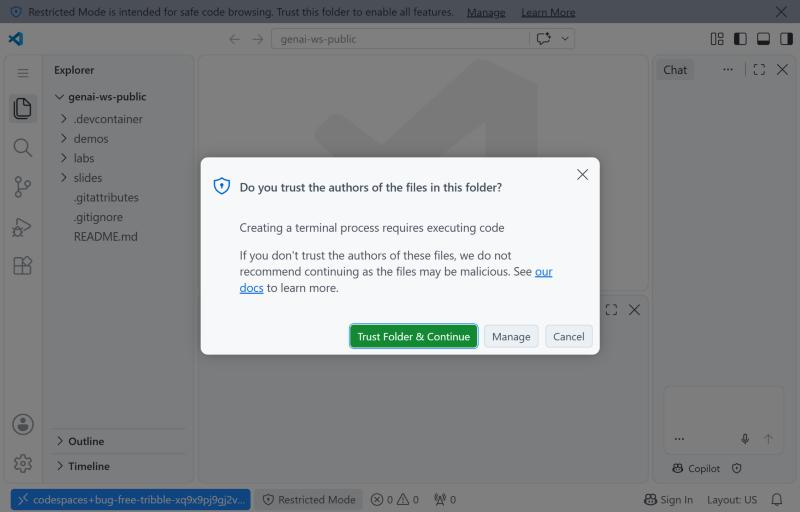
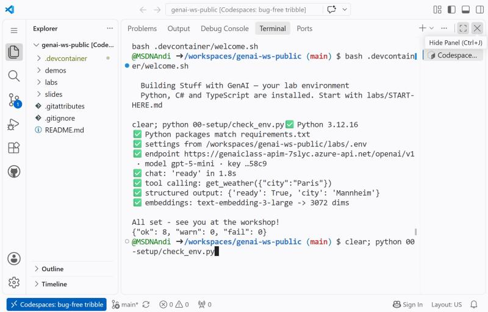
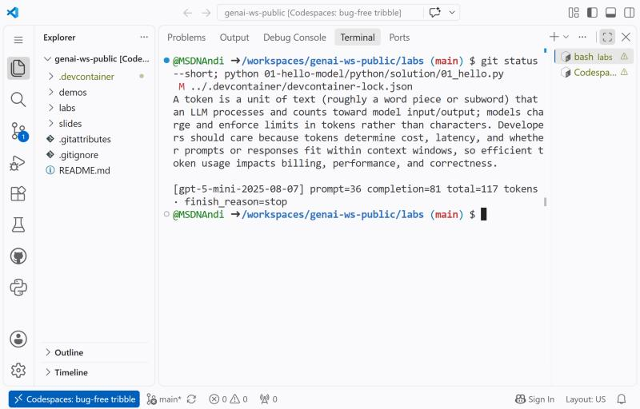
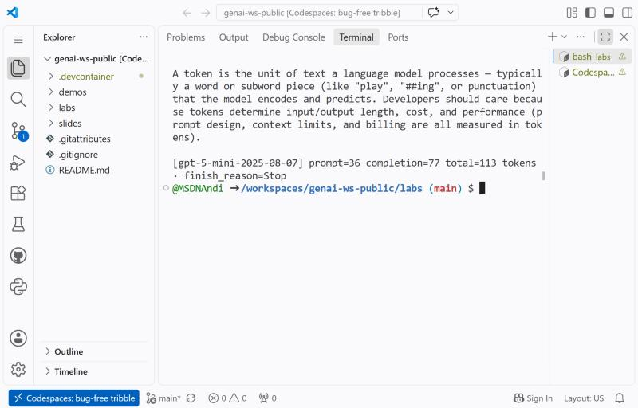
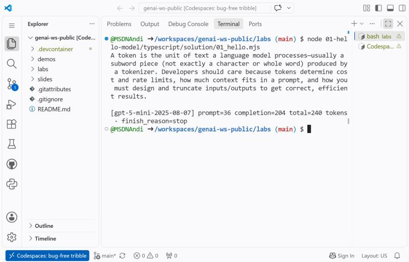

# Walkthrough: your lab environment in the browser (GitHub Codespaces)

No installs. You need a browser, a free GitHub account and the workshop key from your card. It takes about 5 minutes; most of that is waiting.

**Start here:** [codespaces.new/msdnAndi/genai-ws-public?quickstart=1](https://codespaces.new/msdnAndi/genai-ws-public?quickstart=1)

---

## 1. Create the codespace and paste your key

Sign in to GitHub if asked. Leave Branch, Region and Machine type as they are.

Scroll down to **Recommended secrets → GENAI_API_KEY**, paste the key from your card into the box, then click **Create codespace**.
(If you used it before, the box is replaced by "Associated with repository", as in this screenshot: your key is already saved.)

## 2. Wait while it builds (2–5 minutes)

VS Code opens in your browser and shows "Opening Remote…" / "Building codespace…" in the bottom-left corner. Python, C#, TypeScript and every lab package are being installed for you.

## 3. Trust the folder

VS Code asks whether you trust the authors of the files. Click **Trust Folder & Continue** (otherwise the terminal cannot run anything).

## 4. Check the green ticks

A terminal shows the lab environment check. All green and `All set` means: your key works and the models answer.

Red instead? The line tells you what to fix. The usual one: no key. Open `labs/.env`, add `GENAI_API_KEY=<the key from your card>`, save, and run `python 00-setup/check_env.py` again.

## 5. Run your first lab

`labs/START-HERE.md` has one command per language. Copy one into the terminal and press Enter.

**Python**

**C#** (the first run compiles, about 10 seconds)

**TypeScript**

That's it: the labs are in `labs/01-hello-model` … `labs/04-local-media`, each with a README.

## Coming back later (after lunch, tomorrow)

Open the same link. GitHub offers your existing codespace: click **Resume** (everything you did is still there).

## When you're done

Stop or delete the codespace at [github.com/codespaces](https://github.com/codespaces) so it doesn't use your free hours (a personal account includes plenty for this workshop). Want to keep going with your own Azure or OpenAI key? See "Your own endpoint" in [labs/START-HERE.md](../labs/START-HERE.md).

**Notes:**
- A pop-up from the C# extension or a switch to the "Output" tab is harmless: click back to **Terminal**.
- Some company GitHub accounts have Codespaces switched off; use a personal account.
