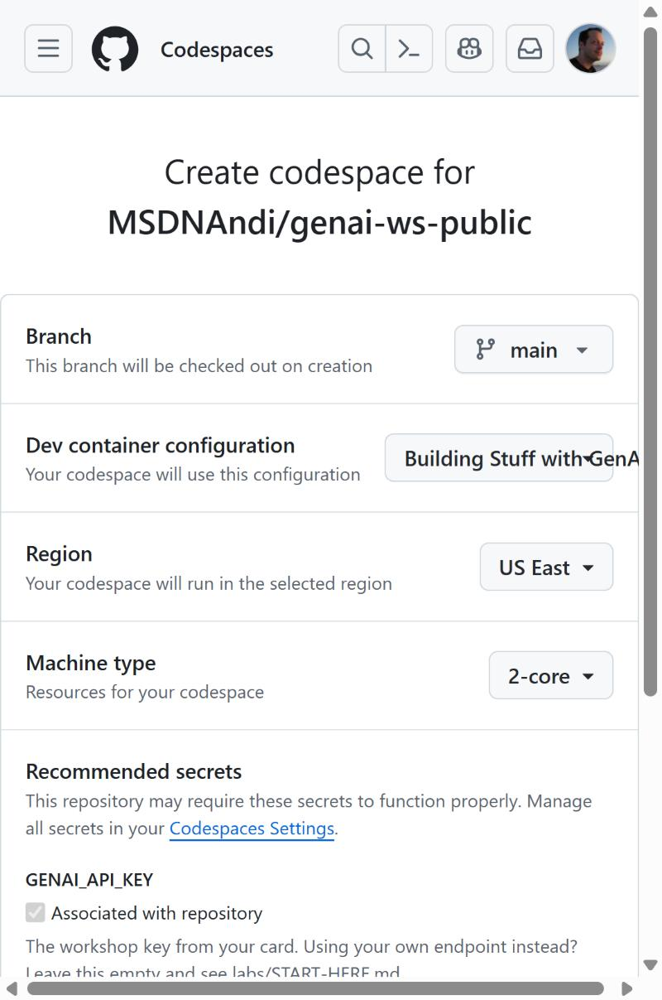
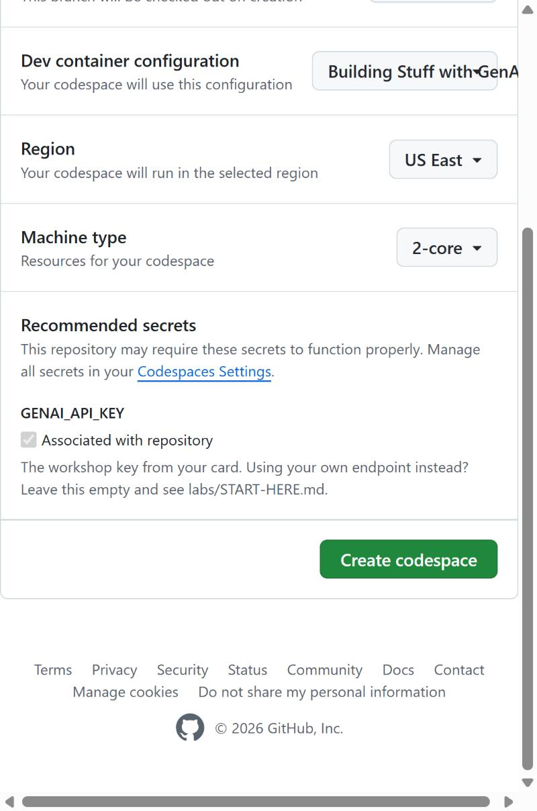
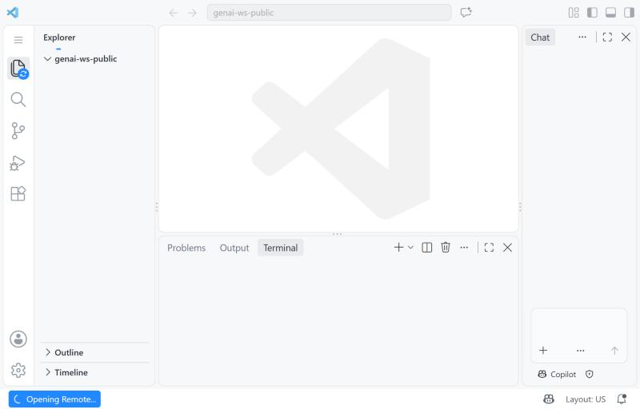
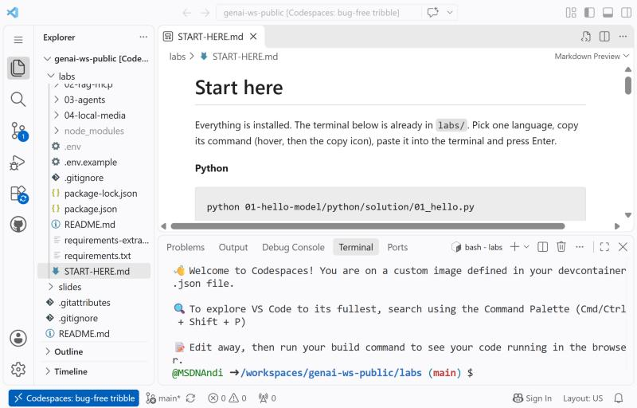
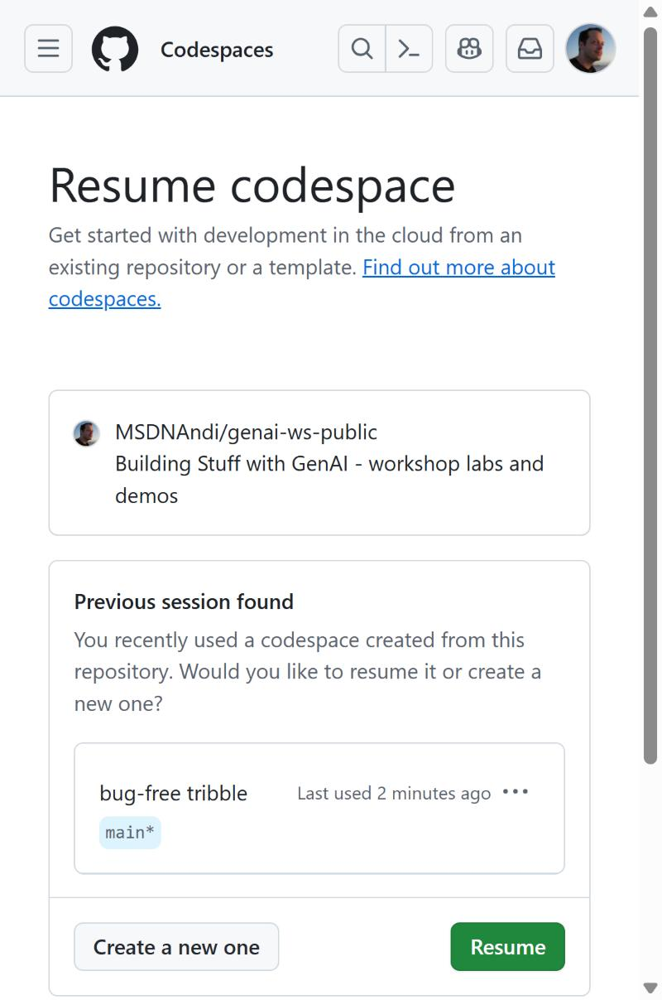
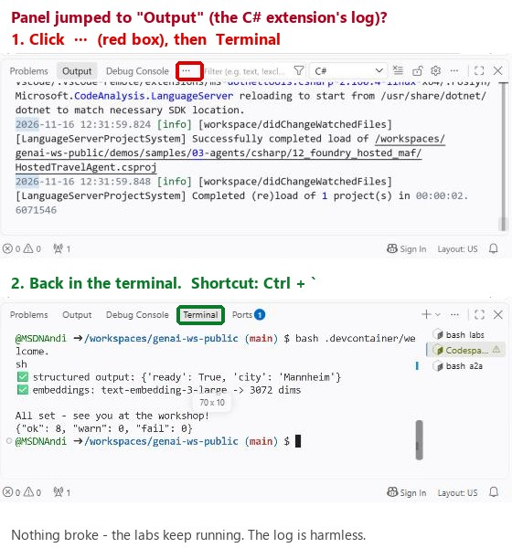
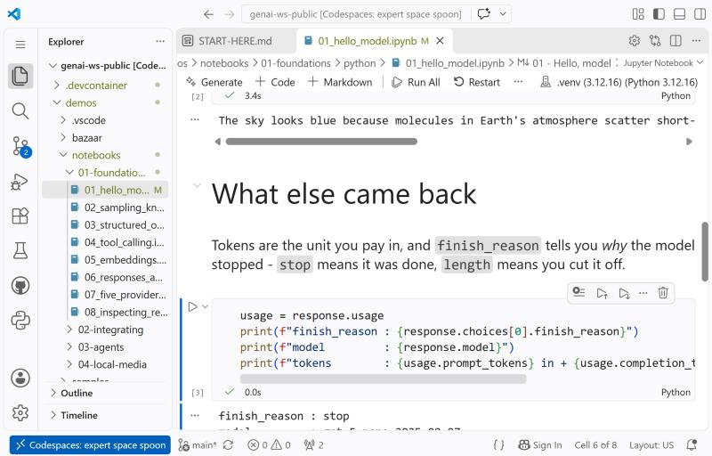

# Walkthrough: your lab environment in the browser (GitHub Codespaces)

No installs. You need a browser, a free GitHub account and the workshop key from your card. It takes about 5 minutes; most of that is waiting.

**Start here:** [codespaces.new/msdnAndi/genai-ws-public?quickstart=1](https://codespaces.new/msdnAndi/genai-ws-public?quickstart=1)

**In short:** open the link → paste your key → wait → run one command. The pictures below show each step.

---

## 1. Create the codespace and paste your key

Sign in to GitHub if asked. Leave everything else on the page as it is.

Scroll down to **Recommended secrets → GENAI_API_KEY**, paste the key from your card into the box, then click **Create codespace**.
(If you used it before, the box is replaced by "Associated with repository", as in this screenshot: your key is already saved.)

## 2. Wait while it builds (2–5 minutes)

VS Code opens in your browser and shows "Opening Remote…" / "Building codespace…" in the bottom-left corner. Everything is being installed for you; there is nothing to do.

## 3. Trust the folder

VS Code asks whether you trust the authors of the files. Click **Trust Folder & Continue** (otherwise the terminal cannot run anything).

## 4. Check the green ticks

A terminal shows the lab environment check. All green and `All set` means: your key works and the models answer.

Red instead? The line tells you what to fix. Usually it's the key: open `labs/.env`, add `GENAI_API_KEY=<the key from your card>`, save, and run `python 00-setup/check_env.py` again.

## 5. Run one command

`labs/START-HERE.md` opens by itself (if not: click it in the Explorer on the left, under `labs`). Pick one language: hover over its command, click the copy icon, paste it into the terminal and press Enter.

**Python**

**C#** (the first run compiles, about 10 seconds)

**TypeScript**

In all three languages the default model (gpt-5-nano, small and cheap) happily explains *authentication* tokens — the question never says "LLM". That is Lab 1's first lesson: put the domain into the system prompt.

That's it: the labs are in `labs/01-hello-model` … `labs/04-local-media`, each with a README.

## Coming back later (after lunch, tomorrow)

Open the same link. GitHub offers your existing codespace: click **Resume** (everything you did is still there).

## When you're done

Stop or delete the codespace at [github.com/codespaces](https://github.com/codespaces) so it doesn't use your free hours (a personal account includes plenty for this workshop). Want to keep going with your own Azure or OpenAI key? See "Your own endpoint" in [labs/START-HERE.md](../labs/START-HERE.md).

**If something looks odd:**
- The panel jumped to **Output** (the C# extension's log)? Harmless. Click **···**, then **Terminal** (or press Ctrl + `):

  

- Some company GitHub accounts have Codespaces switched off; use a personal account.

## Videos

Want to see what a working run looks like before you start? Short recordings of every lab are in
[recordings/](recordings/README.md). The [overview video](recordings/overview.mp4) shows all of them in about 4.5 minutes.

Setup check (`python 00-setup/check_env.py`):

First call in Python, C# and TypeScript:

## Notebooks (the instructor's demos)

The demos from the talk are in `demos/notebooks/` as Jupyter notebooks, ready to run in the same codespace: open one (for example `demos/notebooks/01-foundations/python/01_hello_model.ipynb`) and click **Run All**. Nothing to install or configure: they use the same key and settings as the labs. If VS Code asks for a kernel, pick **Python 3 (labs/.venv)**.

A few notebooks need things a codespace doesn't have (a local GPU model, ComfyUI, a Claude account, an Azure deployment). Their first cell says so, and they stop early with a short explanation; a red `SystemExit` there is expected.
